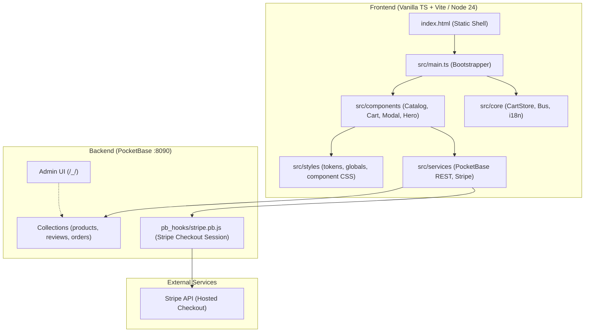
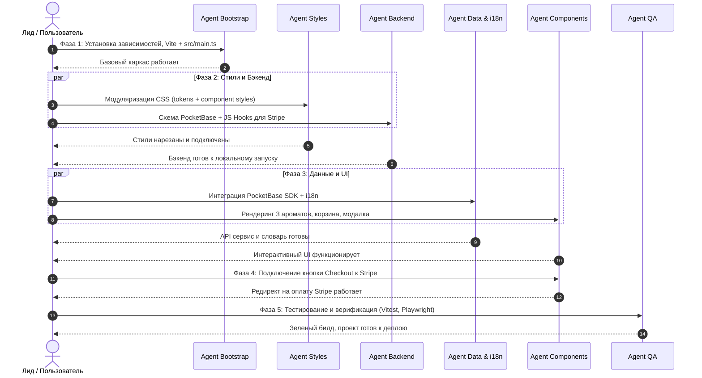

# 🤖 Agentic Workflow — st.noblesse

> **Проект:** Maison de Haute Parfumerie · Luxury Perfume Boutique (SPA)  
> **Стек:** Vanilla TypeScript, Native Node 24 Dev Server (с поддержкой Vite), Покомпонентный CSS (дизайн-токены), PocketBase (SQLite + Auth + File Storage + JS Hooks), Stripe Checkout.  
> **Цель документа:** Распределение задач, зон ответственности, контрактов и готовых промптов для параллельной и последовательной работы AI-агентов.

---

## 🏛️ 1. Архитектурная схема проекта



---

## 🎯 2. Матрица агентов и зон ответственности

| Роль агента | Кодовое имя | Зона ответственности | Входные данные | Критерий готовности (DoD) |
| :--- | :--- | :--- | :--- | :--- |
| **1. Архитектор / Бутстраппер** | `agent-bootstrap` | Настройка dev-сервера / Vite, создание `src/main.ts`, монтирование приложения | `dev-server.mjs`, `package.json`, `index.html` | `npm run dev` запускает проект без ошибок консоли; все модули подключены |
| **2. Бэкенд & Stripe** | `agent-backend` | Схема коллекций PocketBase (`products`, `orders`, `reviews`), JS Hook для сессии Stripe | `products.json`, API Stripe | Файл `pb_schema.json` и `pb_hooks/stripe.pb.js` готовы к локальному запуску |
| **3. Данные, API & i18n** | `agent-data` | Сервис PocketBase (`src/services/pocketbase.ts`) на чистом `fetch` с локальным фоллбеком, модуль локализации `i18n.ts` | `src/core/types.ts`, `src/data/` | API отдает 3 стартовых товара из PB или JSON; строки вынесены в словарь |
| **4. Стилизация & Токены** | `agent-styles` | Нарезка `css/styles.css` на дизайн-токены, сброс, глобальные и покомпонентные стили | `css/styles.css`, `tokens.css` из анализа | Монолитный CSS разделен на файлы в `src/styles/` и `src/components/`, агрегирован в `main.css` |
| **5. Динамические компоненты** | `agent-components` | Рендеринг карточек каталога, модального окна духов, корзины и тостов по контрактам | `COMPONENT_CONTRACTS.md`, `src/components/` | Каталог рендерит 3 аромата, добавление в корзину обновляет счетчик и общую сумму |
| **6. QA & Тестирование** | `agent-qa` | Unit-тесты для Store/i18n (`node:test`), E2E-тест заказа (Headless Chrome CDP) | Все файлы `src/`, `tests/` | `npm test` и `npm run test:e2e` проходят со 100% успехом (15 unit, full E2E) |

---

## 📅 3. Фазы выполнения (Roadmap)



---

## 📝 4. Готовые промпты для агентов

#### Агент 1: Infrastructure & Bootstrapper (`agent-bootstrap`)
> **Задача:** Подготовить основу проекта для перехода с монолита на модульный Vanilla TS с dev-сервером.
>
> **Инструкции:**
> 1. Настрой запуск dev-сервера через `dev-server.mjs` (Node 24 native type stripping) и `vite.config.ts`.
> 2. В [index.html](file:///c:/Users/Alithis/Desktop/st.noblesse/index.html) подключи сборку стилей `<link rel="stylesheet" href="src/styles/main.css">` и модуль `<script type="module" src="/src/main.ts"></script>`.
> 3. Создай файл `src/main.ts`, который:
>    - Импортирует глобальные стили (`import './styles/main.css'`);
>    - Инициализирует шину событий `bus` и реактивные хранилища `cartStore`, `uiStore`, `catalogStore`;
>    - Монтирует базовые компоненты (Header, Preloader, Cursor, Particles, ToTop);
>    - Вызывает инициализацию каталога, корзины, отзывов и подписку на события.
> 4. Проверь команду `npm run dev` (`http://localhost:3000`).

---

### Агент 2: Backend & Stripe Specialist (`agent-backend`)
> **Задача:** Создать схему PocketBase и хуки для работы со Stripe Checkout.
>
> **Инструкции:**
> 1. Создай директорию `pocketbase/` (с `pb_data/` и `pb_hooks/`).
> 2. Сформируй файл миграции схемы `pocketbase/pb_schema.json` со следующими коллекциями:
>    - `products`:
>      - `name` (text, required), `slug` (text, unique)
>      - `family` (select: 'floral', 'oriental', 'woody', 'fresh')
>      - `gender` (select: 'Unisex', 'Men', 'Women')
>      - `badge` (text, optional: 'Signature', 'Limited')
>      - `desc` (text)
>      - `notes_top`, `notes_heart`, `notes_base` (json)
>      - `price_50`, `price_100` (number)
>      - `rating` (number), `reviews_count` (number)
>      - `image` (text)
>    - `reviews`:
>      - `author` (text), `content` (text), `rating` (number), `location` (text)
>    - `orders`:
>      - `stripe_session_id` (text), `customer_email` (email), `items` (json), `total` (number), `currency` (text), `status` (select: 'pending', 'paid', 'failed')
> 3. Добавь стартовый сид в `pocketbase/seed.json` (3 аромата: *Azure Épure*, *Ambre Velours*, *Oud Serein*).
> 4. Создай PocketBase JS Hook `pb_hooks/stripe.pb.js`:
>    - Эндпоинт `POST /api/create-checkout-session`:
>      - Принимает список `items: [{ productId, volume, qty }]`.
>      - Вычисляет серверную стоимость по данным из БД (защита от подделки цен клиентом).
>      - Применяет порог бесплатной доставки (€150).
>      - Создает сессию через Stripe REST API или возвращает локальную mock-сессию, если ключ не задан.
>    - Эндпоинт `POST /api/stripe-webhook` для подтверждения успешной оплаты (`checkout.session.completed`) и создания записи в коллекции `orders`.

---

### Агент 3: Data, API & i18n Specialist (`agent-data`)
> **Задача:** Разработать типизированный слой работы с PocketBase (без тяжёлых внешних зависимостей) и модульную систему переводов.
>
> **Инструкции:**
> 1. Создай файл `src/services/pocketbase.ts`:
>    - Класс `PocketBaseService` на чистом `fetch` с таймаутом `AbortController`.
>    - Метод `getProducts()`: запрос к коллекции `products`. При ошибке сети или оффлайне бэкенда возвращает локальный фоллбек из `src/data/products.json`.
>    - Метод `getReviews()`: получение отзывов с фоллбеком на `src/data/reviews.json`.
>    - Метод `createCheckout(items)`: отправка запроса на `/api/create-checkout-session` с mock-фоллбеком.
> 2. Создай модуль локализации `src/core/i18n.ts`:
>    - Тип `Locale = 'en' | 'ru' | 'fr'`.
>    - Словари `src/data/locales/{en,fr,ru}.json` (тексты: кнопки, бейджи, уведомления, корзина, навигация).
>    - Реактивный метод `t(key: string, params?: Record<string, string>): string`.
>    - Сохранение выбранного языка в `localStorage` и автоматическое переключение классов интерфейса.

---

### Агент 4: Styles & Design Tokens Specialist (`agent-styles`)
> **Задача:** Декомпозировать монолитный `css/styles.css` на дизайн-токены и покомпонентные файлы.
>
> **Инструкции:**
> 1. Создай в `src/styles/` файлы:
>    - `tokens.css`: палитра (золото `#c8a24d`, фон `#0a0e1a`, шрифты Didot/Playfair/Cormorant, отступы, тени, z-index).
>    - `reset.css`: сброс стилей, box-sizing, typography defaults.
>    - `globals.css`: общие классы (`.btn`, `.btn-gold`, `.wrap`, утилиты).
> 2. Создай стили для каждого компонента рядом с его кодом:
>    - `src/components/hero/hero.css`
>    - `src/components/catalog/catalog.css`
>    - `src/components/cart-drawer/cart-drawer.css`
>    - `src/components/product-modal/product-modal.css`
>    - `src/components/header/header.css`
>    - `src/components/footer/footer.css`
>    - `src/components/toast/toast.css`
> 3. Создай главный мастер-файл `src/styles/main.css`, собирающий все модули через `@import`.
> 4. Убедись, что визуальный стиль премиум-бутика полностью сохранен, анимации и hover-эффекты работают без искажений.

---

### Агент 5: UI & Components Specialist (`agent-components`)
> **Задача:** Реализовать динамическую генерацию карточек 3 товаров, управление корзиной и интеграцию со Stripe.
>
> **Инструкции:**
> 1. В `src/components/catalog/catalog.ts`:
>    - Реализуй функцию рендеринга `renderProductCard(product: Product)`.
>    - Загрузи 3 стартовых аромата через `src/services/pocketbase.ts` (с fallback на JSON).
>    - Навесь обработчики: выбор объема (50 мл / 100 мл), кнопка «Add to Bag», клик по карточке для открытия модалки.
> 2. В `src/components/product-modal/product-modal.ts`:
>    - Обеспечь заполнение модального окна выбранным ароматом (ноты, описание, переключение объема, цена).
>    - Добавь поддержку фокус-ловушки (Trap Focus) для доступности (a11y).
> 3. В `src/components/cart-drawer/cart-drawer.ts`:
>    - Подпишись на изменения `cartStore`.
>    - Отображай выбранные позиции, пересчет суммы и прогресс-бар бесплатной доставки (порог €150).
>    - При клике на кнопку «Checkout» вызывай метод создания платежной сессии `createCheckout(cartItems)` и выполняй переход по полученному `checkoutUrl`.
> 4. При добавлении товара показывай уведомление через `src/components/toast/toast.ts`.

---

### Агент 6: QA & Verification Specialist (`agent-qa`)
> **Задача:** Гарантировать стабильность, отсутствие регрессий, доступность и верификацию E2E.
>
> **Инструкции:**
> 1. Настрой запуск легковесных юнит-тестов на нативном раннере `node:test` (`tests/unit/*.test.mjs`) с ESM loader для TS.
> 2. Напиши юнит-тесты:
>    - `tests/unit/cart-store.test.mjs`: добавление товаров, пересчет объемов 50/100 мл, расчет скидки/бесплатной доставки, удаление позиций, очистка корзины.
>    - `tests/unit/catalog-store.test.mjs`: фильтрация по семействам, поиск по ID, динамическая гидрация.
>    - `tests/unit/format.test.mjs`: форматирование евро (`€89`, `€129`).
>    - `tests/unit/i18n.test.mjs`: подстановка ключей и фоллбеки словаря EN/FR/RU.
> 3. Напиши автономный E2E-тест (`test-e2e.mjs`) на базе Chrome DevTools Protocol (CDP):
>    - Проверка загрузки дизайн-токенов (`--gold`, `--serif`) и структуры DOM.
>    - Переключение языков EN → FR → RU с мгновенным обновлением навигации.
>    - Добавление духов *Azure Épure* в корзину -> открытие Drawer -> проверка суммы €89 -> клик по Checkout -> генерация номера заказа.
> 4. Проверь доступность (a11y) клавиатурной навигации (`Tab`, `Esc` для закрытия модалки и корзины, Trap Focus).

---

## 🔒 5. Контракты данных (TypeScript Data Contracts)

### Модель духов в приложении (Client Domain Model `src/core/types.ts`)
```typescript
export type Family = 'floral' | 'oriental' | 'woody' | 'fresh';
export type Gender = 'Unisex' | 'Men' | 'Women';
export type Volume = '50' | '100';

export interface Notes {
  top: string[];
  heart: string[];
  base: string[];
}

export interface Product {
  id: string;                    // URL-slug, например 'azure-epure'
  img: string;                   // Ключ изображения ('p8')
  name: string;                  // 'Azure Épure'
  fam: Family;                   // Парфюмерное семейство
  gender: Gender;                // Целевая аудитория
  badge: string;                 // Бейдж ('Signature', 'Limited Edition', '')
  desc: string;                  // Описание и пирамида
  notes: Notes;                  // Верхние, сердечные и базовые ноты
  price: Record<Volume, number>; // { '50': 89, '100': 129 }
  rating: number;                // 4.9
  rev: number;                   // Количество отзывов
}
```

> **Маппинг из PocketBase в клиентскую модель:**  
> Поля БД PocketBase (`products`) трансформируются в сервисе `src/services/pocketbase.ts`:
> - `r.slug || r.id` → `product.id`
> - `r.family` → `product.fam`
> - `r.image` → `product.img`
> - `r.reviews_count` → `product.rev`
> - `r.price_50` / `r.price_100` → `product.price['50']` / `product.price['100']`

### Запрос на Checkout (Stripe / PocketBase Session)
```typescript
export interface CheckoutPayloadItem {
  productId: string;
  volume: '50' | '100';
  qty: number;
}

export interface CheckoutResponse {
  checkoutUrl: string;
  sessionId?: string;
  total?: number;
  currency?: string;
  mock?: boolean;
}
```

---

## 🚀 6. Порядок запуска для разработки

1. **Запуск бэкенда PocketBase:**
   ```powershell
   .\pocketbase\pocketbase.exe serve --http="127.0.0.1:8090" --dir=pocketbase/pb_data --hooksDir=pb_hooks
   ```
   *REST API:* `http://127.0.0.1:8090/api/`  
   *Админ-панель:* `http://127.0.0.1:8090/_/` (управление товарами, отзывами и заказами).

2. **Запуск фронтенда (Node 24 native / Vite):**
   ```bash
   npm run dev
   ```
   *Приложение:* `http://localhost:3000` (zero-dependency native type stripping dev server).

3. **Верификация качества:**
   ```bash
   npm test          # 15 модульных тестов (Node:test)
   npm run test:e2e  # E2E тестирование в headless Chrome CDP
   ```
